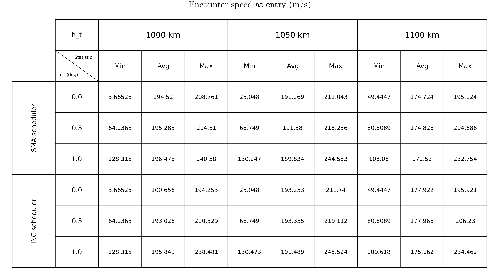
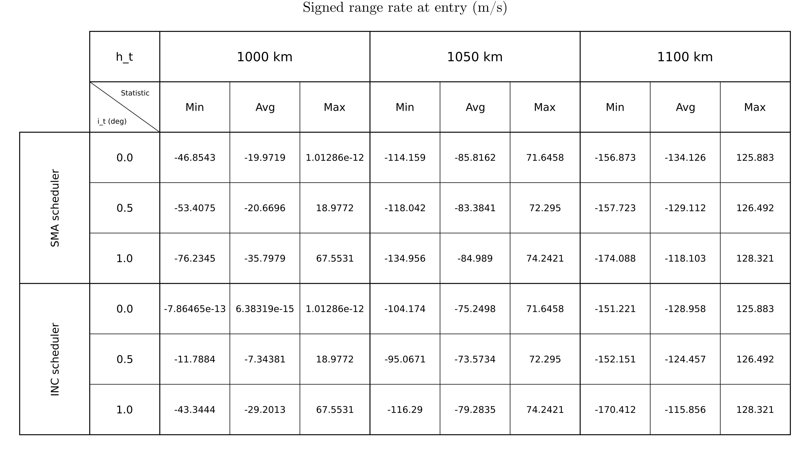
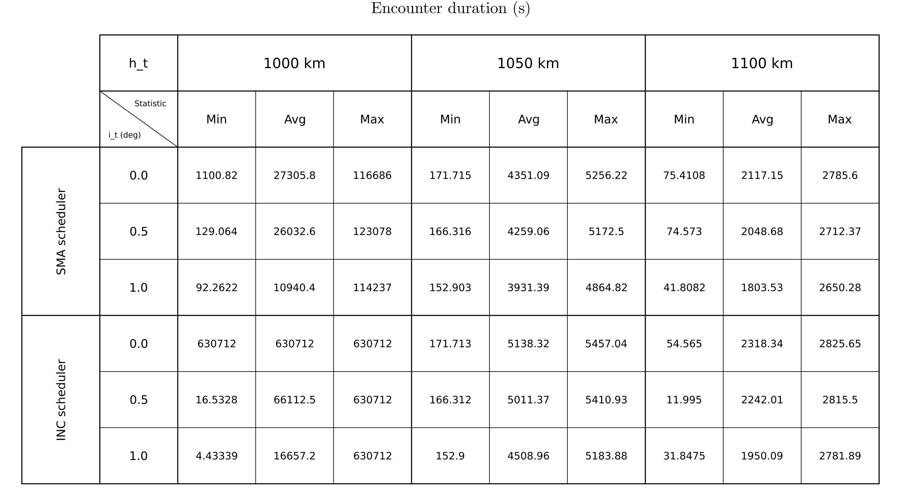
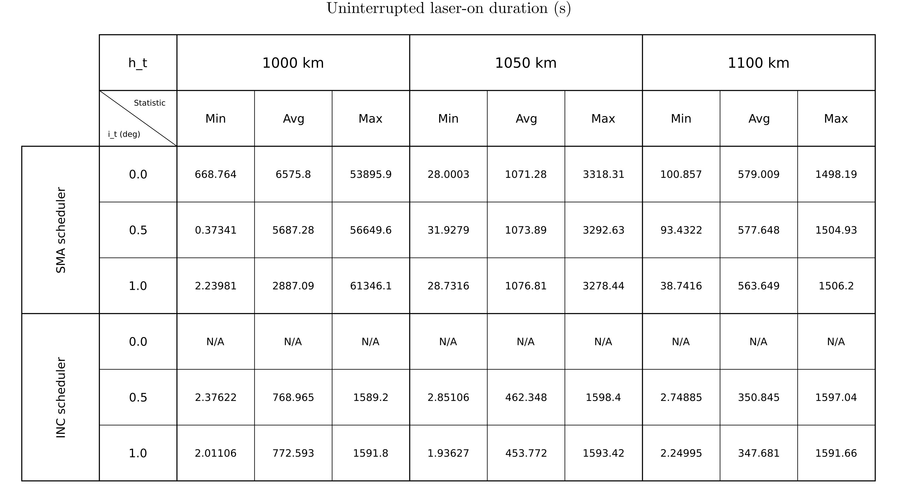

# Page 1. Encounter speed at entry

**Ordering assumption:** the request repeated encounter duration on pages 1 and 3; page 1 is interpreted as encounter speed to cover all four quantities.

**Definition:** One relative-speed value per geometric encounter, calculated from the saved entry velocities. This is not the minimum or maximum speed during the encounter.

**Scope:** target-helper pairs; 100 initial target periods; initial target h_t and i. Each Min/Avg/Max group pools all events over helper counts 1, 100, 200, 300, 400, 500, 600, 700 and 800 at that scheduler/h_t/i setting (nine cases). Boundary-clipped events are included. Avg is the arithmetic event-weighted mean, not an equal-case mean or a within-encounter time average. Values use m/s, rounded to six significant digits; N/A means no observations.

[Open full-resolution table](parameter_page_1_table.png) | [PDF table](parameter_page_1_table.pdf)

## Conclusion

- Across all cells, the observed values span **3.66526 to 245.524 m/s**. One cell attaining the upper bound is **gve_inc, h_t = 1050 km, i = 1.0 deg**.
- The maximum observed entry speed increases from i = 0 to 0.5 to 1.0 deg in **6 of 6 scheduler/altitude groups**. This describes the upper bounds, not an increase in every encounter's speed.
- These bounds describe **speed at encounter entry**, not closest-approach speed, encounter-average speed, or the maximum speed reached later. For encounters already in range at simulation start, entry refers to the initial saved state.
- SMA and INC min-max ranges overlap in **9 of 9** matched altitude/inclination cells with observations from both. Min/max alone describe extremes, not typical behavior, statistical uncertainty, or scheduler superiority.

*Data: [full-precision table values and counts](parameter_pages_min_max.csv); [source CSV checksums](parameter_pages_sources.csv). Tables and conclusions are generated from the exported table CSV.*

---

# Page 2. Signed range rate at entry

**Definition:** One signed range-rate value per geometric encounter at its saved entry state: negative means approaching, positive means receding. This is not the within-encounter range-rate envelope.

**Scope:** target-helper pairs; 100 initial target periods; initial target h_t and i. Each Min/Avg/Max group pools all events over helper counts 1, 100, 200, 300, 400, 500, 600, 700 and 800 at that scheduler/h_t/i setting (nine cases). Boundary-clipped events are included. Avg is the arithmetic event-weighted mean, not an equal-case mean or a within-encounter time average. Values use m/s, rounded to six significant digits; N/A means no observations.

[Open full-resolution table](parameter_page_2_table.png) | [PDF table](parameter_page_2_table.pdf)

## Conclusion

- Across all cells, the observed values span **-174.088 to 128.321 m/s**. One cell attaining the upper bound is **gve_sma, h_t = 1100 km, i = 1.0 deg**.
- There are **324 positive entry range-rate observations**, of which **324** are start-clipped. A positive value therefore must not automatically be interpreted as a normal inward range crossing; an encounter may already be in range at t = 0.
- SMA and INC min-max ranges overlap in **9 of 9** matched altitude/inclination cells with observations from both. Min/max alone describe extremes, not typical behavior, statistical uncertainty, or scheduler superiority.

*Data: [full-precision table values and counts](parameter_pages_min_max.csv); [source CSV checksums](parameter_pages_sources.csv). Tables and conclusions are generated from the exported table CSV.*

---

# Page 3. Encounter duration

**Definition:** Observed time from entry to exit of the 200 km geometric encounter range, with one duration per target-helper encounter.

**Scope:** target-helper pairs; 100 initial target periods; initial target h_t and i. Each Min/Avg/Max group pools all events over helper counts 1, 100, 200, 300, 400, 500, 600, 700 and 800 at that scheduler/h_t/i setting (nine cases). Boundary-clipped events are included. Avg is the arithmetic event-weighted mean, not an equal-case mean or a within-encounter time average. Values use s, rounded to six significant digits; N/A means no observations.

[Open full-resolution table](parameter_page_3_table.png) | [PDF table](parameter_page_3_table.pdf)

## Conclusion

- Across all cells, the observed values span **4.43339 to 630712 s**. One cell attaining the upper bound is **gve_inc, h_t = 1000 km, i = 0.0 deg**.
- For **gve_inc, h_t = 1000 km, i = 0.0 deg**, all **32** saved encounters span the complete run. Its equal Min/Max values describe the observation window, not measured complete encounter lifetimes.
- **938 of 74130 encounters are boundary-clipped**, including **81 spanning the full run**. Long observed durations can be limited by the simulation window; they are not necessarily complete encounter lifetimes.
- SMA and INC min-max ranges overlap in **8 of 9** matched altitude/inclination cells with observations from both. Min/max alone describe extremes, not typical behavior, statistical uncertainty, or scheduler superiority.

*Data: [full-precision table values and counts](parameter_pages_min_max.csv); [source CSV checksums](parameter_pages_sources.csv). Tables and conclusions are generated from the exported table CSV.*

---

# Page 4. Uninterrupted laser-on duration

**Definition:** Duration of each uninterrupted firing interval, including held out-of-range firing. This matches the scheduler-separated laser plot, not summed laser-on time per geometric encounter.

**Scope:** target-helper pairs; 100 initial target periods; initial target h_t and i. Each Min/Avg/Max group pools all events over helper counts 1, 100, 200, 300, 400, 500, 600, 700 and 800 at that scheduler/h_t/i setting (nine cases). Boundary-clipped events are included. Avg is the arithmetic event-weighted mean, not an equal-case mean or a within-encounter time average. Values use s, rounded to six significant digits; N/A means no observations.

[Open full-resolution table](parameter_page_4_table.png) | [PDF table](parameter_page_4_table.pdf)

## Conclusion

- Across all cells, the observed values span **0.37341 to 61346.1 s**. One cell attaining the upper bound is **gve_sma, h_t = 1000 km, i = 1.0 deg**.
- At **h_t = 1000 km**, the longest observed uninterrupted firing is **61346.1 s for SMA**, versus **1591.8 s for INC**. SMA reaches much longer intervals here, but these maxima do not quantify how frequently they occur.
- **No firing intervals exist in 3 cells** (gve_inc, h_t = 1000 km, i = 0.0 deg; gve_inc, h_t = 1050 km, i = 0.0 deg; gve_inc, h_t = 1100 km, i = 0.0 deg), representing **27 cases**. Their Min/Max entries are N/A, not zero-duration firing intervals.
- Longer uninterrupted firing is not, by itself, evidence of better orbital control. Compare with total duty fraction and the scheduler's intended orbital-change objective.
- SMA and INC min-max ranges overlap in **6 of 6** matched altitude/inclination cells with observations from both. Min/max alone describe extremes, not typical behavior, statistical uncertainty, or scheduler superiority.

*Data: [full-precision table values and counts](parameter_pages_min_max.csv); [source CSV checksums](parameter_pages_sources.csv). Tables and conclusions are generated from the exported table CSV.*

