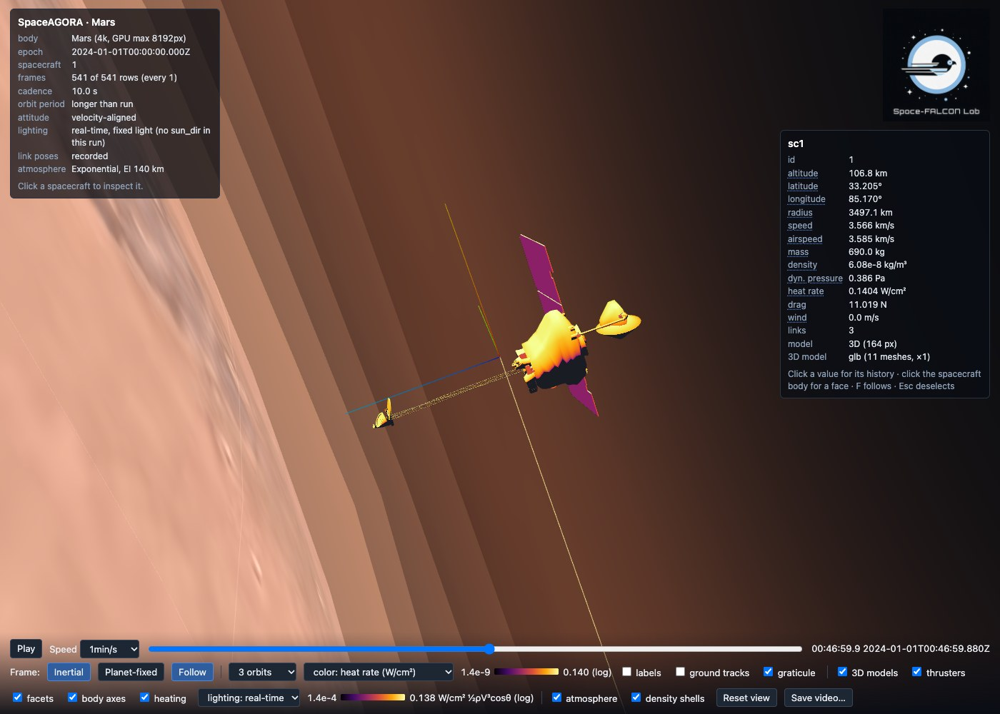

# SpaceAGORA.jl

[](https://github.com/Space-FALCON-Lab/SpaceAGORA.jl/actions/workflows/julia-ci.yml)
[](https://space-falcon-lab.github.io/SpaceAGORA.jl/)
[](https://julialang.org/downloads/)
[](LICENSE)

SpaceAGORA is a Julia simulator for spacecraft that fly in or near a planet's
atmosphere. It models aerobraking, entry, aerocapture and orbital flight around
Earth, Mars, Venus, Titan and the Moon, with guidance and control in the loop.
It also simulates spacecraft constellations, including their orbital layouts,
inter-satellite links and ground-station contacts. The Space-FALCON Lab at the
University of Michigan develops it.



*A Mars aerobraking pass in the interactive viewer. Spacecraft model: NASA/JPL/Eyes on the Solar System.*

**[Documentation](https://space-falcon-lab.github.io/SpaceAGORA.jl/)** ·
[Quickstart](https://space-falcon-lab.github.io/SpaceAGORA.jl/user/quickstart/) ·
[Tutorial](https://space-falcon-lab.github.io/SpaceAGORA.jl/tutorials/odyssey_surrogate/) ·
[Publications](https://space-falcon-lab.github.io/SpaceAGORA.jl/publications/)

## Get started

SpaceAGORA needs Julia 1.12. In a terminal on Linux or macOS:

```text
GIT_LFS_SKIP_SMUDGE=1 git clone --filter=blob:none https://github.com/Space-FALCON-Lab/SpaceAGORA.jl
cd SpaceAGORA.jl
julia --project=. -e "using Pkg; Pkg.instantiate(julia_version_strict=true)"
julia --startup-file=no examples/setup.jl
julia --project=examples examples/AGORA_Basic_Quickstart.jl
```

The clone options skip large data files that the first run does not need. The
third command installs SpaceAGORA with the package versions in the committed
manifest; `julia_version_strict=true` makes it stop with a clear message if your
Julia is not 1.12. The fourth prepares the examples environment, which adds the
plotting and analysis packages the examples use and keeps the versions the root
manifest records. The last one flies an Earth orbit that needs no atmosphere
data, GRAM or SPICE kernels, and writes its results and plots under `output/`.

On Windows, set `GIT_LFS_SKIP_SMUDGE` in a command of its own before cloning.
The [Quickstart](https://space-falcon-lab.github.io/SpaceAGORA.jl/user/quickstart/)
gives the commands for PowerShell and Command Prompt, a check that the
installation works, and what the run prints.

The command-line tool can run the same example as a short check. It starts the
example in the examples environment, so prepare that first:

```text
julia --project=. src/interfaces/cli/main.jl run --example=AGORA_Basic_Quickstart.jl --smoke
```

## What you can simulate

- **Atmospheric flight**: aerobraking, entry and aerocapture with analytic,
  NRLMSISE-00, frozen GRAM grid or native NASA GRAM atmospheres, including heat
  rates and heat loads.
- **Gravity and perturbations**: point mass, J2, spherical harmonics, third
  bodies, solar radiation pressure and gravity-gradient torque.
- **Vehicles**: rigid, articulated and compliant spacecraft carrying thrusters,
  reaction wheels, control-moment gyros, torque rods, panel hinges, laser
  terminals or actuator kinds of your own, plus sensors, a power budget and
  onboard data storage.
- **Guidance and control**: your own controllers in the loop, energy-depletion
  aerobraking guidance, rendezvous planning and powered lunar descent with
  plume-surface interaction.
- **Constellations**: custom orbital planes and Walker delta or star layouts,
  with spacecraft ids, plane and slot assignments. Propagate interacting
  spacecraft together with inter-satellite links and guidance, or run uncoupled
  spacecraft as independent ensembles in parallel. Merge member results into
  constellation tables that retain each spacecraft's identity.
- **Missions and campaigns**: operational segments, phases and events within a
  run; Monte Carlo campaigns in parallel; ground-station contacts.
- **Results**: CSV and Feather tables with a manifest, plots, an interactive 3D
  viewer, and a verification study that grades runs against reconstructed Mars
  Odyssey and Venus Express trajectories and a GMAT Earth reference.

## What installs separately

The core package above is everything the first run needs. These pieces are
separate, each in a Julia environment of its own:

- The HYPR motion planner, the MuJoCo contact-scene companion and the
  energy-depletion guidance (EDG) kernels are companion repositories pinned
  under `packages/`. `scripts/optional_packages.jl` checks one out and installs
  it; see [packages/README.md](packages/README.md) and the
  [installation guide](https://space-falcon-lab.github.io/SpaceAGORA.jl/user/installation_environment/).
- The browser viewer is the SpaceAGORAVisualizer package, installed with
  `scripts/setup_visualizer.jl`, as
  [Interactive Visualization](https://space-falcon-lab.github.io/SpaceAGORA.jl/user/visualization/)
  describes.
- Native NASA GRAM is not distributed here. NASA grants access on request;
  [GRAMSuite setup](https://space-falcon-lab.github.io/SpaceAGORA.jl/user/gramsuite_setup/)
  covers the request and how to connect the files with SPICE kernels.

## Learn more

- [Configuring a Simulation](https://space-falcon-lab.github.io/SpaceAGORA.jl/user/simulation_configuration/):
  build your own scenario.
- [Constellations](https://space-falcon-lab.github.io/SpaceAGORA.jl/user/constellations/):
  build orbital layouts, choose coupled or independent propagation, and read
  constellation results.
- [Odyssey guidance with a frozen atmosphere](https://space-falcon-lab.github.io/SpaceAGORA.jl/tutorials/odyssey_surrogate/):
  a complete aerobraking exercise without licensed data.
- [Interactive Visualization](https://space-falcon-lab.github.io/SpaceAGORA.jl/user/visualization/):
  open a run in the 3D viewer.
- [Extensibility](https://space-falcon-lab.github.io/SpaceAGORA.jl/extensibility/):
  add your own forces, atmospheres, actuators and controllers.

## Contributors

The following people have contributed to SpaceAGORA, listed alphabetically by
surname:

- Mohammed Fadag
- [Giusy Falcone](https://github.com/gfalcon2)
- [Jakob Gorisek-Gazze](https://github.com/jgorisek)
- [Giovanni Romagnoli](https://github.com/GiovanniRomagnoli)
- [Nihal Simha](https://github.com/NihalSimha)
- [Kuang Sun](https://github.com/Kuang-Sun)
- [Evan Yu](https://github.com/EvanY14)

## Citing

If you use SpaceAGORA, please cite it with the metadata in
[CITATION.cff](CITATION.cff); GitHub's "Cite this repository" button turns it
into BibTeX. Papers built on SpaceAGORA are listed on
[Publications](https://space-falcon-lab.github.io/SpaceAGORA.jl/publications/).

## Contributing and license

The [contributor guide](CONTRIBUTING.md) covers the repository layout, source
ownership and release checks. SpaceAGORA is released under the
[MIT License](LICENSE).
