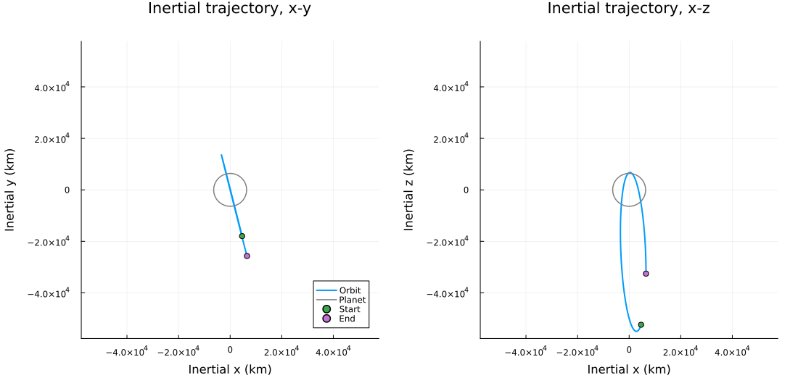

# Quickstart

This page takes you from a fresh clone to a first simulation on your own
machine. The run needs neither GRAM nor SPICE: it propagates an Earth orbit
with J2 gravity, no atmosphere (`NoAtmosphereModel()`) and the analytic
ephemerides (`SimpleEphemeridesModel()`).

The committed root manifest pins the package versions used by this checkout’s
root environment. Instantiating it installs those versions. The examples run in a second environment, the examples environment,
which one setup command prepares from that manifest; it adds the packages the
examples use for plots and analysis.

SpaceAGORA requires Julia 1.12 (any 1.12.x release), and `julia --version`
must say so before you start. Julia 1.11 and earlier, and 1.13 and later, are
refused, as described under
[Julia version](installation_environment.md#Julia-version).

Command blocks on this site say where they are typed: "Terminal" is the shell
prompt (PowerShell or Command Prompt on Windows, a terminal on Linux/macOS),
and "Julia REPL" is the `julia>` prompt inside a running Julia session.

Terminal, Linux/macOS. The first line creates the checkout and the remaining
lines run inside it; that directory, the repository root, is where every later
command on this site starts:

```text
GIT_LFS_SKIP_SMUDGE=1 git clone --filter=blob:none https://github.com/Space-FALCON-Lab/SpaceAGORA.jl
cd SpaceAGORA.jl
julia --project=. -e "using Pkg; Pkg.instantiate(julia_version_strict=true)"
julia --startup-file=no examples/setup.jl
julia --project=examples examples/AGORA_Basic_Quickstart.jl
```

On Windows the variable is set in a separate statement, and the remaining four
lines above then run unchanged. Terminal, Windows PowerShell:

```text
$env:GIT_LFS_SKIP_SMUDGE = "1"
git clone --filter=blob:none https://github.com/Space-FALCON-Lab/SpaceAGORA.jl
```

Terminal, Windows Command Prompt:

```text
set GIT_LFS_SKIP_SMUDGE=1
git clone --filter=blob:none https://github.com/Space-FALCON-Lab/SpaceAGORA.jl
```

`GIT_LFS_SKIP_SMUDGE=1` leaves the seven GRAM surrogate grids under
`data/planets/gram_surrogate/` as small Git LFS pointers. Together the grids
are about 2.6 GB and nothing on this path reads them; `git lfs pull --include
"data/planets/gram_surrogate/*"` fetches them later if a benchmark study needs
them.

`julia_version_strict=true` makes the package manager stop with one clear
message on a Julia release other than 1.12, instead of continuing into
unrelated errors. `examples/setup.jl` prepares the examples environment
(`examples/Project.toml`); run it again after a pull that changes the root
`Manifest.toml`.
[Installation & Environment](installation_environment.md#Examples-environment)
describes both environments.

What to read next:

- [Assets & Modes](../assets.md)
- [Your First Script](first_script.md)
- [Simulation Outputs](outputs.md)
- [Recipes](recipes.md)

## Check the setup

Before the first run, confirm the installation. Terminal, from the repository
root:

```text
julia --version
julia --project=. -e "using SpaceAGORA; println(pkgdir(SpaceAGORA))"
```

Expected: `julia version 1.12.` followed by the patch number, then the absolute
path of your checkout. The first time, the second command also precompiles the
package and shows its progress while it does. Anything else it prints points
to a problem, and [Troubleshooting](troubleshooting.md) maps the common
messages to their causes. The Julia REPL form of this check is on
[Installation & Environment](installation_environment.md#Check-the-installation).

A check in the Julia REPL that also builds the no-GRAM baseline environment
and confirms it has no atmosphere:

```jldoctest
julia> using SpaceAGORA

julia> env = make_no_gram_environment();

julia> env.density_model isa NoAtmosphereModel
true
```

## What to expect

Installation time depends on your connection and on which Julia packages are
already installed. The first run also compiles code, so it takes longer than
later runs. The example runs with `verbose=true`, so it prints the initial
state of each spacecraft (position in m, velocity in m/s, mass in kg and
accumulated heat loads in J/cm²); it then prints the number of saved samples
and the computational time, and writes:

```text
output/
  simulation_results.csv
  simulation_results.feather
  simulation_results.manifest.toml
  plots/
    quickstart_altitude_speed.png
    quickstart_inertial_trajectory.png
    quickstart_3d_orbit.png
    quickstart_ground_track.png
```

`output/` is the `output/` directory at the repository root, which Git
ignores. Running this example again overwrites its previous files;
[Simulation Outputs](outputs.md) shows how to keep runs apart.

The plots show the geodetic altitude, the osculating periapsis altitude and the
inertial speed against time; the trajectory projected on the inertial x-y and
x-z planes, with the planet's equatorial radius drawn for scale; the same
trajectory in 3D; and the ground track. The example's orbit is nearly polar, so
its x-y projection is close to a line, and its ground track runs along the top
and bottom edges of the map while it passes the poles, where all longitudes
meet.

The first two plots from a run of this example:




## What this run gives you

The no-GRAM example is the shortest path to a working simulation that uses
only what the repository contains. It needs no local GRAM installation, no
SPICE kernels, no surrogate atmosphere grids and nothing from the
`data/GRAMSuite.jl` submodule, which stays empty in a fresh clone.

## If you prefer the CLI

The same run through the command-line tool. The tool itself runs in the root
project and starts the example in the examples environment prepared above.
Terminal, from the repository root:

```text
julia --project=. src/interfaces/cli/main.jl run --example=AGORA_Basic_Quickstart.jl --output-dir=output/cli_run
```

`--output-dir` keeps this run's files apart from those of the script run
above: they land under `output/cli_run/` with the same names. `--smoke` runs a
short mission, at most 120 simulated seconds, that only checks the path end to
end. It honors `--output-dir` too; without one, smoke mode writes to `output/`
under the directory you run from. Reusing a directory overwrites the previous
run's files.

## Run the same scenario without plots

`AGORA_Earth_NoGRAM.jl` runs the same 12-hour Earth scenario, with
`make_no_gram_planet(:earth)` and `SimpleEphemeridesModel()`, and writes the
same three result files under `output/` without making plots. Terminal, from
the repository root:

```text
julia --project=examples examples/AGORA_Earth_NoGRAM.jl
```

Through the command-line tool, keeping its files in their own directory:

```text
julia --project=. src/interfaces/cli/main.jl run --example=AGORA_Earth_NoGRAM.jl --output-dir=output/cli_run
```

`Earth_Thruster_Test.jl` builds its planet with `Earth("", SPICE_PATH)` and
needs the SPICE kernels in the `data/GRAMSuite.jl` submodule; on a fresh clone
it stops with `Required SPICE kernel not found`. Run it after
[GRAMSuite Setup](gramsuite_setup.md).

## When to stop using this page

Move on when you need higher-fidelity assets or licensed data
([Assets & Modes](../assets.md)), when you want a scenario of your own rather
than the baseline example ([Your First Script](first_script.md)), when you want
to read the files written under `output/` ([Simulation Outputs](outputs.md)),
or when you want the verification study rather than a first run
([Verification Study](verification_study.md)).
