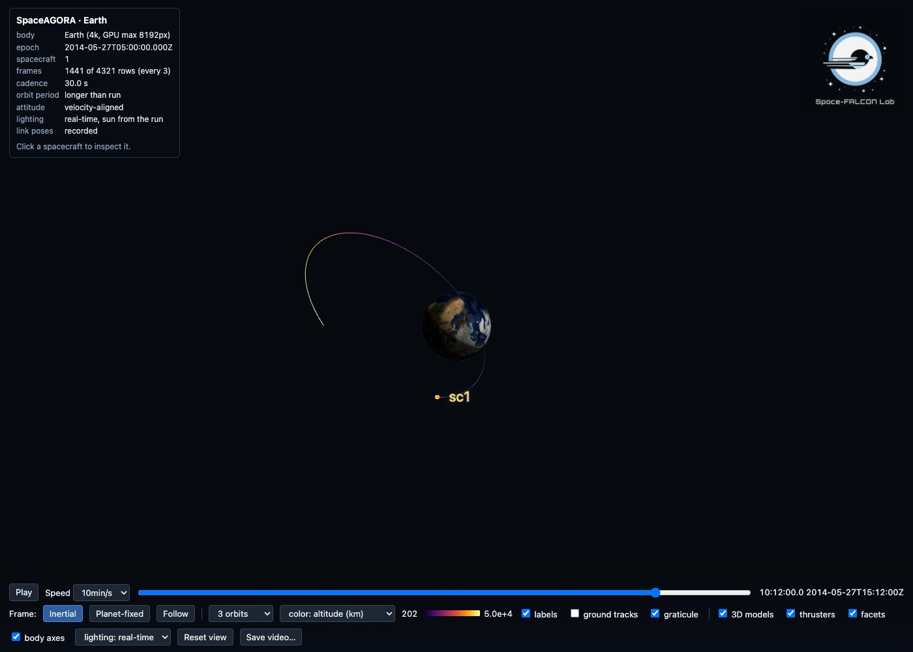
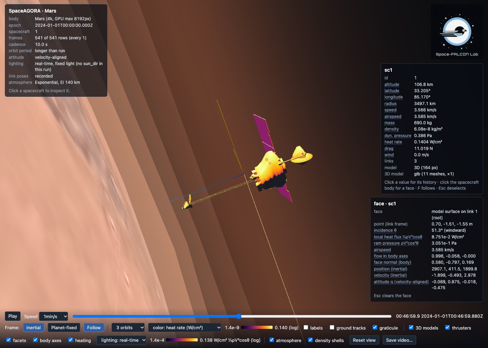

# Interactive Visualization

!!! note "Optional package"
    Requires the optional `SpaceAGORAVisualizer` package; see
    [Install the optional viewer](#Install-the-optional-viewer).

The viewer turns saved results into an HTML page on which you can orbit the
central body, scrub through time, select a spacecraft and inspect its
trajectory. The page opens from disk and can be shared with someone who does
not have Julia.

## Install the optional viewer

SpaceAGORA writes the scene data and portable viewer JSON. The separate
[SpaceAGORAVisualizer package](https://github.com/Space-FALCON-Lab/SpaceAGORAVisualizer.jl)
builds the HTML page, plays it back in the browser and carries the third-party
renderer assets. From the repository root, install the tested pair into a
separate environment and start Julia in it:

```sh
julia --project=. scripts/setup_visualizer.jl .visualizer-env
julia --project=.visualizer-env
```

Then load both packages in Julia:

```julia
using SpaceAGORA
using SpaceAGORAVisualizer
```

The helper installs SpaceAGORAVisualizer 0.2.0, which draws recorded interlink
windows and ground-station markers, from the immutable revision recorded in
`packages/VisualizerSource.toml`. The renderer contract between the two
packages is version 1. The helper does not change the root project. You can
also install the viewer alone in another Julia environment to open exported
JSON without loading SpaceAGORA; the companion's README describes that
installation and the input it accepts.

A simulation can save results and scene data without the viewer installed.
`export_viewer_payload(prefix; textures=false)` converts those saved files
into a portable `*_viewer.json`, without the planet texture, and
`SpaceAGORAVisualizer.visualize(path)` turns that file into a self-contained
HTML page. Asking SpaceAGORA for an HTML page needs both packages loaded, in
either order. Without the viewer, such a request fails with a clear error
before the simulation or visualization campaign starts.

For a reusable mission definition with a single returned run handle, start
with [Define, run and inspect a mission](mission_workflows.md).

## Make your first page

After the [Quickstart](quickstart.md), run this in the viewer environment from
the repository root. It runs the no-GRAM Earth example and writes its results
and page to their own directory:

```julia
using SpaceAGORA
using SpaceAGORAVisualizer
SpaceAGORA.run_cli(["run", "--example=AGORA_Earth_NoGRAM.jl", "--visualize",
                   "--output-dir=output/viewer-earth"])
```

Open `output/viewer-earth/simulation_results_viewer.html` in the repository.
The same directory holds the normal results and
`simulation_results_scene.json`. Running the command again overwrites these
files, so choose another `--output-dir` to keep an earlier run.
[Simulation Outputs](outputs.md) describes the output files in full.



In this screenshot the trail is colored by altitude, chosen with the trail-color selector. The run has no atmosphere, so the default heat-rate coloring has nothing to show.

For a configuration you have already built:

```julia
run_simulation(args; visualization=true)
```

The page is written next to the results as
`<results_directory>/simulation_results_viewer.html`, where
`results_directory` is `args.simulation_settings.results_directory`.

For a completed run that saved its scene sidecar, either of these builds the
page:

```julia
export_visualization("output/viewer-earth/simulation_results"; max_frames=2000)
SpaceAGORA.run_cli(["visualize", "--run=output/viewer-earth"])
```

`export_visualization` takes the results prefix,
`<results_directory>/simulation_results`, without a file extension. The CLI's
`visualize --run=` accepts either that prefix or the results directory.

`with_visualization_scene(args, true)` turns the sidecar flag on while you
prepare a configuration. The run then saves the extra fields and the sidecar,
and `export_visualization` builds the HTML page afterwards. A run saved
without a sidecar needs its configuration to create one; otherwise use the
standalone data-file page described below.

## Read the page

- Drag to orbit, scroll to zoom, and use the timeline to play or scrub.
- Click a spacecraft marker or visible model to select it. Its selection
  panel opens at the top right. Press F to follow it; Escape clears the
  selection.
- Switch between the inertial and planet-fixed views. Ground tracks follow the
  body's rotation, sampled from the run's own frame model.
- Nearby spacecraft show their link boxes and articulated parts. A run without
  attitude data gets an illustrative velocity-aligned orientation.
- Quaternions are scalar-last. The instantaneous altitude is geodetic, while
  `sc1_periapsis_altitude` and the default ensemble color are spherical
  periapsis altitudes, as defined on [Output Columns](output_columns.md).

The saved heat-rate history comes from the simulation. The surface heating
colors are an illustrative overlay drawn by the viewer, not a second thermal
solution. The dynamic pressure the viewer derives uses the velocity it has at
hand, an approximation; use the verified study diagnostics when you need
quantitative atmosphere-relative pressures.

## Plot another saved value

Click a quantity's name or value in the selection panel to plot its history.
Altitude, speed, mass, density, heat rate, drag and wind have clickable rows
whenever the run saved the data behind them.

To add another saved column, such as `sc1_periapsis_altitude`, pass its name
without the spacecraft prefix. That column holds the osculating spherical
periapsis altitude in meters:

```julia
export_visualization("output/viewer-earth/simulation_results";
    channels=[(column="periapsis_altitude", label="Spherical periapsis altitude",
               unit="m", digits=1, log=false)])
```

Reopen the page, select a spacecraft and click its **Spherical periapsis
altitude** row in the selection panel. Scrubbing the timeline updates the
value shown. Channel names are the saved column names; see
[Output Columns](output_columns.md) for their units and definitions.

Every spacecraft must have the column (`sc1_periapsis_altitude`,
`sc2_periapsis_altitude`, and so on). If any spacecraft lacks it, the channel
is left out without a message, so if the row does not appear, check the
spelling and the columns of every spacecraft in the results table.

Missing values appear as gaps, and the plot does not interpolate across a gap.
Some plots switch to a logarithmic axis on their own when their positive values
span a wide range. Zeros also appear as gaps on that axis; clear the **log**
checkbox to show them on a linear scale. Negative values turn the logarithmic
axis off.

When the saved rows repeat a spacecraft's state after an impact or touchdown
while the run goes on, those held values plot as flat segments. The viewer
plots the saved rows as they are and does not end a history at deactivation.

Channel values are decimated with the same saved rows as the trajectory, so
choose a `max_frames` large enough to keep the features you want to see.

## Size and optional detail

```julia
export_visualization("output/viewer-earth/simulation_results";
    max_frames=2000, data_budget_mb=150.0,
    texture_resolution="4k", trail_orbits=3, frame=:inertial)
```

The exporter decimates the saved rows to fit the frame and data limits, and the
page reports the resulting cadence.

Positions are embedded as Float64 for runs of up to 64 spacecraft. Above that
they stay Float64 when that keeps the same frames as Float32 within
`max_frames` and `data_budget_mb`, and become Float32 otherwise. Float32
resolves about half a meter at 7000 km, so close formations can jitter.
`position_precision=:f64` keeps Float64 at the cost of frames, and
`position_precision=:f32` forces Float32. With mission segments, `:f64` can
refuse an export that `:auto` completes, because the boundary rows must fit the
budget as Float64 frames. The ensemble export applies the same rule to its
total number of sample spacecraft.

Smaller textures, or `textures=false`, make the page smaller; no texture
setting changes the recorded trajectory. Export uses
`texture_resolution="4k"` by default. Earth, Mars and the Moon also have 8192
x 4096 textures: ask for them with `texture_resolution="8k"`, or take the
largest available tier with `:best`. Venus and Titan fall back to 4k. An 8k
image has four times the pixels of a 4k one, and its embedded JPEG makes the
HTML larger too. The companion's standalone builder defaults to
`--textures none`. To embed local textures with it, pass `--textures 4k` or
`--textures 8k` together with `--textures-dir /path/to/catalog`. That directory
must contain `manifest.toml` and the selected image files; the builder
downloads nothing.

STL, OBJ, glTF (with embedded buffers) and GLB files can replace the link
boxes. A GLB or glTF file that requires Draco or meshopt compression, or Basis
textures, is refused:

```julia
export_visualization("output/viewer-earth/simulation_results";
    models=Dict(1 => "data/scene/models/iss_nasa_3d_resources_b.glb"),
    model_scale=2.4, model_rotation_deg=Dict(1 => (-90, 0, -90)))
```

Keys are spacecraft IDs; match the ID, scale (meters per model unit) and
orientation to your model. The model is display geometry only; it does not
replace the aerodynamic or structural model. `data/scene/models/README.md` and
`data/scene/textures/manifest.toml` record where the assets come from. Besides
the ISS, the checkout includes display meshes of the Apollo Lunar Module,
Cassini with and without Huygens, CYGNSS, Magellan and Mars Odyssey. Pass the
GLB path through `models`; a model is embedded only when you select it. Each
needs its own mission-specific scale and rotation. These six models and the
three 8k textures take about 36 MB of the checkout. No asset download and no
native atmosphere library is needed.

The atmosphere displays use the density values already saved along the
trajectory. The sidecar also gets an altitude profile for the exponential and
piecewise exponential models and for the native-free `GRAMGridAtmosphereModel`.
These samples read the model without advancing a sampler or changing its
epoch.

A fixed-grid profile is taken at the equator and longitude zero, over the
overlap of the grid's altitude coverage with the range from zero to 1.5 times
the entry-interface altitude. A grid that does not cover the equator gets no
profile, and the viewer draws no density shells outside the sampled altitude
range. A global density map is included only when the grid covers every
sampled latitude, so a regional grid is never stretched over the globe. The map
is drawn at 0.6 times the entry-interface altitude by default, kept within the
grid's altitude range, and the sidecar records that height. These displays
show the stored grid snapshot, not an atmosphere generated anew for the
simulation epoch.

Native GRAM, hybrid native and surrogate, empirical and custom models keep the
entry-interface shell and the saved trajectory density, with no extra model
queries at export. `atmosphere_spec(args; sample_model=true, density_params=...)`
remains available as an explicit, advanced call that can change such a
model's state; scene export never makes it.

## Toolbar and keyboard

The toolbar holds the playback controls and speed, the **Inertial** and
**Planet-fixed** frame buttons, **Follow**, the trail length and trail color
selectors, and one checkbox per overlay: labels, planned paths, interlinks,
reference ghosts, ground tracks, graticule, 3D models, thrusters, plumes,
facets, body axes, heating, dust, atmosphere, density shells and density map.
A data-dependent overlay hides its checkbox when the page has no data for it.
The lighting selector and **Save video…** are described below, and
**Reset view** returns the camera to its starting position. A run with mission
segments also gets segment and transition selectors (see
[Follow mission segments](#Follow-mission-segments)).

| Key | Action |
|---|---|
| Space | Play or pause |
| Left or Right arrow | Step back or forward by one speed unit |
| F | Follow the selected spacecraft |
| Escape | Clear the selected face, then the selected spacecraft |

Trails can be colored by age, heat rate, dynamic pressure, density, altitude
or speed. The default is heat rate when the run saved it, and age otherwise.
Heat rate, dynamic pressure and density use logarithmic color scales; altitude
and speed use linear ones.

## Close-up models, thrusters and plumes

When a spacecraft's bounding radius covers more than a few pixels, its marker
gives way to the assembly recorded in the sidecar: one box per link from
`Link.dims`, placed by the saved attitude quaternion. A run without attitude
state gets an attitude with body +x along the velocity and body +z toward
nadir. Non-root links follow the `link_pose` columns when the run saved them,
and their configured pose otherwise. Thrusters are cones with the apex at the
thruster location, pointing along the thrust direction; facets are translucent
squares of the facet's area with their normal drawn; and the body axes are
red, green and blue for x, y and z. Each has a toolbar toggle.

A model passed through `models` replaces the boxes, and the glyphs stay. Parts
that the file holds in another position can be posed with
`model_articulations`, which takes the same specification as
`articulate_triangles`, so that the drawn model and an articulated aerodynamic
mesh agree:

```julia
export_visualization("output/viewer-earth/simulation_results";
    models=Dict(1 => "data/scene/models/iss_nasa_3d_resources_b.glb"), model_scale=2.4,
    model_articulations=Dict(1 => [
        (region=(x_min=10.0,), axis=(0.0, 1.0, 0.0), angle_deg=90.0, pivot=:centroid)]))
```

Each articulation names a `region` (an axis-aligned box in model units with
`x_min`, `x_max`, `y_min`, `y_max`, `z_min` and `z_max`, where a missing bound
is unbounded), a rotation `axis` in model axes, an `angle_deg`, and a `pivot`:
a point on the axis in model units, or `:centroid` (the default) for the center
of the selected vertices' bounding box. The vertices inside the region rotate.

Thruster firing levels saved with the run (the `thruster_level` field; see
[Output Columns](output_columns.md#Visualization-fields)) drive a plume on
every thruster: an additive, flickering pair of cones along the thruster's
direction, long and orange-white for a main engine and short and blue-white for
an attitude jet. The rated thrust and the level set its reach and brightness,
with the level raised to a fractional power so that a jet firing at a fraction
of a percent of its rating is still visible. Level 0 draws nothing and dims the
static cone. The selection panel lists a **thruster k level** row for each
thruster; click it to plot the firing history. The plumes are display glyphs
driven by the recorded levels and carry no exhaust physics.

## Heating overlay and face inspection

With density and velocity in the frames, the **heating** toggle colors every
link box and model face by ½ρV³cosθ on an inferno scale, logarithmic over three
decades below the run's peak. θ is the angle between the outward face normal
and the velocity relative to the rotating atmosphere (inertial velocity minus
ω × r); this display approximation does not subtract winds. Faces turned away
from the flow stay cold, and the legend reads W/cm². The overlay is built by
the viewer from the saved density and the drawn geometry. It is not the
simulation's thermal solution, and `sc1_heat_rate` remains the saved
stagnation value.


A Mars aerobraking pass with drag, drawn with the NASA Mars Odyssey model from `data/scene/models/` (NASA/JPL/Eyes on the Solar System, NASA 3D Resources).

Click a face of a drawn assembly to inspect it. The face panel reports the
incidence θ in degrees, the local heat flux ½ρV³cosθ in W/cm², the ram pressure
ρV²cos²θ in Pa, the airspeed, the flow direction and the face normal in body
axes, and the spacecraft's inertial position and velocity, all updated as the
timeline plays. Each row plots like any other channel. Escape clears the face
selection before the spacecraft selection.



## Sun lighting and path tracing

When the run saved the Sun direction (the `sun_dir` field, written when the
run's ephemerides can locate the Sun), the page lights the scene from it. It
uses a directional sun with a shadow map fitted to the followed vehicle, and an
exposure computed from the ground texture's mean albedo and the Sun's elevation
at the site rather than a fixed value, so the surface renders at the same
brightness every time the page opens. Without `sun_dir` the page uses a fixed
light without shadows and says so in its information panel.

The lighting selector always offers **lighting: real-time**, and on the
default self-contained page, which embeds its renderer, that is the only
choice. A page whose import map includes the optional path tracer also offers
**lighting: path traced when paused**. Pages from the companion's standalone
builder in `--cdn` mode include it, and so do pages converted with
`SpaceAGORAVisualizer.jl/viewer/build_cdn_page.py` unless `--no-pathtracer` is
given. The GPU path tracer loads while the page starts, refines the still
image whenever playback is paused, and hands back to real-time rendering while
the timeline moves. When the tracer cannot load, the selector offers real-time
lighting only and the browser console records why. Lighting is a rendering
choice and changes no saved quantity.

## Reference ghosts and planned paths

`references` draws reference trajectories, such as a SPICE reconstruction, a
telemetry record or a plan, as translucent ghosts of a flown spacecraft on the
run's own timeline. Each entry is a NamedTuple or Dict with `name`, `t_s`
(elapsed seconds from the run epoch, non-decreasing), `pos_m` (3 × N inertial
meters) and, optionally, `vel_mps` (3 × N), `q` (4 × N scalar-last
body-to-inertial attitude; velocity-aligned when absent), `target` (the 1-based
index of the spacecraft whose geometry and model the ghost copies, default 1),
`color` (a hex string), `opacity` (0 to 1, default 0.45) and `trail` (whether
to draw the whole reference line, default true):

```julia
export_visualization("output/viewer-earth/simulation_results";
    references=[(name="reconstruction", t_s=t, pos_m=r, vel_mps=v,
                 target=1, color="#ffcc66", opacity=0.5)])
```

The export keeps the times and positions in Float64. The separation shown
still depends on how the reference is sampled and interpolated. The flown
spacecraft's selection panel shows its separation from each ghost that refers
to it as a **vs name** row, in km. A ghost is hidden at times outside its
reference table.

`paths` overlays reference polylines. Each entry has `name`, `points_m`
(3 × N meters) and `frame`: `:inertial`, `:rtn` for the radial, transverse and
normal frame of spacecraft `target`, or `:body` for that spacecraft's body
frame. `color` and `dashed` are optional. RTN and body paths are rebuilt every
frame from the target's saved state, so a planned approach stays attached to a
moving target:

```julia
export_visualization("output/viewer-earth/simulation_results";
    paths=[(name="approach", points_m=plan_m, frame=:rtn, target=2, dashed=true)])
```

## Robot arms

A spacecraft carrying the compliant robot-arm chain records the `arm_pose`
field: for each arm link, the link's center of mass relative to the spacecraft
in inertial meters, and the link's inertial attitude quaternion. The page draws
one cylinder per link along the link's own vector, a joint sphere at its
origin and a red tip at the end effector, recovering the joint origin in each
frame from the saved center of mass and quaternion. The arm group sits at the
spacecraft without the body rotation, because the poses are already inertial.

## Landing dust

With the default save-field list, a run with the plume-surface effector saves
the seven `sc{i}_plume_*` columns described in
[Plume interaction](plume_interaction.md) and listed on
[Output Columns](output_columns.md#Plume-interaction). The page reads them
into its plume block, and with the **dust** toggle it draws the regolith that
the descent engine blows off the surface: a particle sheet fed by the saved
erosion rate, ejecta speed, eroded mass and engine height, a ground haze disk
and a scour mark. The dust sits on the terrain radius when a site bundle is
exported, and on the reference globe otherwise. It illustrates the saved
diagnostics; the plume page describes the erosion closure itself.

## Save a video

**Save video…** opens a dialog with the time range, the playback speed in
simulated seconds per second of video, the frame rate (24, 30 or 60 frames per
second) and the output size (the canvas size, 1280 × 720, 1920 × 1080 or
2560 × 1440), and shows the resulting video length and frame count. The page
renders the range frame by frame, encodes it as H.264 with the browser's
WebCodecs encoder and builds an MP4 in memory before offering the download;
the live view stands still while it records. **Record WebM (10 s)** is the
fallback for browsers without an H.264 encoder: it records ten seconds of the
live playback with MediaRecorder. Both files are made in the browser, and
nothing leaves the machine.

## Ensembles

```julia
result, page = run_monte_carlo_visualization(
    seed -> build_args(seed), 1:20, "output/campaign"; threads=4)
```

Here `build_args(seed)` is your own function that returns a configuration for
a seed. Each sample writes to its own results and checkpoint directories, also
when the builder supplies a shared checkpoint directory, and each sample must
use the wide results layout. The page shows all the trajectories together and
colors them by their final spherical periapsis altitude; pass `scalar` and
`scalar_name` to color by another quantity. To export a campaign that has
already run, use `export_ensemble_visualization("output/campaign")`.

## Standalone files

```text
python3 <SpaceAGORAVisualizer-checkout>/viewer/build_standalone.py --out output/viewer.html
```

Open the page and choose a CSV or JSON file, a body and an epoch. A CSV can
have SpaceAGORA result columns, or `time,x,y,z` with optional velocity and
quaternion columns. Check the units and the inertial-frame convention before
you interpret the view. The standalone page approximates the body's rotation;
it does not replace the frame metadata a simulation saves.

The default page embeds its renderer and assets and makes no network requests,
although an imported model with external resource URLs can request them. For a
host that refuses embedded `data:` scripts,
`SpaceAGORAVisualizer.jl/viewer/build_cdn_page.py` rewrites an exported page to
load the pinned three.js and mp4-muxer from `cdn.jsdelivr.net`, with the
renderer modules inlined. The rewritten page lists its network hosts and the
third-party notices in its footer, and it loads fonts from Google Fonts only
with `--fonts`. See
[the companion renderer guide](https://github.com/Space-FALCON-Lab/SpaceAGORAVisualizer.jl/blob/76f9037edb61e19e7314eb4db9bb7772a42f2ddc/viewer/README.md)
for renderer development, the module layout and licensing. Landing dynamics
and plume-surface physics are not part of the viewer: the page draws only what
the run saved.

## Regional terrain in exported pages

For a completed Moon run with a scene sidecar, add a local terrain bundle:

```julia
export_visualization("output/moon-run/simulation_results";
    terrain="output/terrain/site.json", terrain_max_grid=512)
```

Reopen `output/moon-run/simulation_results_viewer.html`. The site bundle holds
`site.json`, the named DEM metadata with its `.f32` samples, and optional JPEG
tiles. The Moon download tools and the converter for older imagery bundles live
in `scripts/dev/terrain/`, and
[Building lunar terrain and imagery](lunar_imagery_sources.md) explains their
Python requirements, commands, data sources and output layout. Downloading
assets is a separate step; a local bundle exports without a network connection
or native GRAM.

The bundle follows the `load_site_terrain` conventions: regional DEMs in
priority order, an explicit common reference radius, planetocentric latitude,
east-positive longitude, and little-endian Float32 heights in meters at cell
centers. Export reads it with that loader, keeps the original outer edges, and
samples reduced grids uniformly at their new cell centers.
`terrain_max_grid` must be an integer from 1 to 2048. The reduction factor is
shared, so it can leave a single row or column. The result approximates the
source surface: `site.height_m` records the height from the source, while
markers and radar queries use the exported approximation.

The first grid that covers a point supplies its height, with a height of zero
outside every grid. Longitude wraps without iteration. Radar clearance is
radial: `norm(position_body_m) - reference_radius_m - terrain_height_m`. The
terrain radius comes from the DEM, also for dust placement, while the scene's
planet metadata is kept. If the scene globe is an ellipsoid or uses another
radius, the terrain boundary can differ from that globe. The run and the
terrain must refer to the same body; use one reference sphere for both to
align their datums. Even with matching radii, expect a visible rim where the
regional terrain meets the reference globe at a different height. Export
converts no datums.

Select a spacecraft and read its **height above terrain** in the selection
panel. With a single spacecraft, **Follow** also selects it. This value is a
radial clearance over the exported grid, not the saved geodetic altitude. Zoom
toward the site to see the local imagery mesh.

Imagery is optional. Without it, the height queries and the
height-above-terrain readout still work, and the normal globe is drawn. With a quadtree,
every declared local JPEG is embedded, and a missing declared index or tile is
an error. Each tile has `level`, `x`, `y`, `file` and a positive `m_per_px`.
The root tile is required, and sparse deeper levels inherit the nearest
available ancestor. The index uses a regional `root`, an integer `tile_px` and
a matching `max_level`. Source, attribution and resolution metadata go with
the imagery.

To bound the export size, a site accepts at most 64 DEMs and 128 MiB of DEM
samples, with at most 1 MiB per JSON document. Imagery accepts at most 8192
tiles, levels up to 20, 4096 pixels per tile side, 8 MiB per JPEG and 128 MiB
in total. Each tile's dimensions are checked against its JPEG header. Paths,
including symbolic links, must resolve inside the site or imagery directory.
Export downloads no terrain and does not change propagation, touchdown or
atmosphere state.

## Follow mission segments

A run made with operational segments carries its executed segment history in
the portable payload. On the viewer page, select a segment or a transition
within the saved playback range to move the timeline to that point.
Transitions outside that range stay listed but cannot be selected. The
current-segment label changes as you play or scrub through the run, and at a
shared boundary it names the incoming segment.

The history records the actual transition times and reasons, including early
stops. It does not infer events from the trajectory or show segments that did
not run as completed. Payloads without a mission history show the usual
timeline. See [Define, run and inspect a mission](mission_workflows.md) for
segment definitions and command actions.
